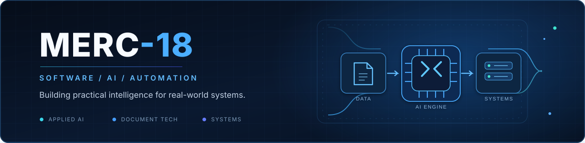

  
  <h3>Ingeniería de software · Inteligencia artificial aplicada · Automatización</h3>
  
Diseño soluciones, desarrollo software y dirijo su implementación técnica, combinando programación, agentes de IA y validación mediante pruebas.

## 👋 Sobre mí

Me enfoco en transformar problemas operativos en **herramientas funcionales, verificables y mantenibles**. Trabajo desde el diseño de la arquitectura y los contratos hasta la implementación, integración y revisión de resultados.

- **Software engineering:** Python, APIs, integración de sistemas, pruebas y automatización.
- **AI engineering:** procesamiento documental, extracción estructurada, modelos locales y visión.
- **Technical leadership:** descomposición de problemas, coordinación de agentes de desarrollo, revisión de código y control de calidad.
- **Document intelligence:** PDF, Excel, OCR y flujos de validación de información.

## 🛠 Tecnologías

**Lenguajes:** Python · TypeScript · JavaScript · SQL

**Backend y datos:** FastAPI · REST APIs · PostgreSQL · MySQL · Supabase

**Frontend y herramientas:** React · Git · GitHub Actions · Docker · Linux

**IA y automatización:** Modelos de lenguaje · Ollama · OpenCV · OCR · Agentes de programación

## 🚀 Proyectos públicos destacados

| Proyecto | Enfoque | Tecnologías |
| --- | --- | --- |
| [Ticketera Controlling](https://github.com/Merc-18/ticketera-controlling) | Gestión de tickets, tableros y seguimiento operativo | React, TypeScript, Supabase |
| [extractor-pdf-ia](https://github.com/Merc-18/extractor-pdf-ia) | Extracción de información de documentos PDF con IA | Python, Document AI |
| [AI-ML-Class](https://github.com/Merc-18/AI-ML-Class) | Aprendizaje y experimentación con IA y aprendizaje automático | AI, ML |
| [orca-lab](https://github.com/Merc-18/orca-lab) | Laboratorio de desarrollo y experimentación técnica | Desarrollo, prototipos |

## 🔬 Áreas de trabajo

**Sistemas inteligentes para documentos.** Desarrollo de flujos capaces de interpretar documentos, estructurar resultados, comprobar inconsistencias y exponer capacidades mediante APIs.

**Automatización de operaciones.** Herramientas que reducen trabajo repetitivo y permiten revisar los resultados con evidencia y trazabilidad.

**Desarrollo asistido por IA.** Uso agentes de programación como colaboradores de implementación; mantengo el diseño técnico, las decisiones de integración y la validación del software.

## 📌 Actividad y repositorios

Mi trabajo incluye proyectos públicos y desarrollos privados en preparación. **Los repositorios privados no se presentan como publicaciones ni se comparten aquí antes de su autorización.**

[Explorar mis repositorios públicos](https://github.com/Merc-18?tab=repositories) · [Ver mi actividad en GitHub](https://github.com/Merc-18?tab=overview)

---

Software útil. Arquitectura clara. Pruebas y resultados verificables.

