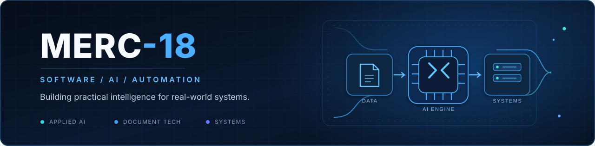

  
   
   
  
   
   
  
<strong>AI Engineering • Document Intelligence • Software Development</strong>

## 👋 Hola, soy Merc-18

Me interesa diseñar y desarrollar **soluciones prácticas de software e inteligencia artificial**, especialmente en automatización de procesos, extracción de información de documentos y sistemas que resuelvan problemas reales.

> **Mi enfoque:** construir soluciones útiles, medibles y mantenibles; conectar modelos de IA con productos y flujos de trabajo reales.

- 🧠 **IA aplicada:** modelos locales, procesamiento de documentos y análisis de imágenes.
- 📄 **Document intelligence:** OCR, extracción de datos y validación de resultados.
- ⚙️ **Ingeniería de software:** APIs, integración, automatización y pruebas.
- 🔍 **Aprendizaje continuo:** exploración de herramientas y tecnologías emergentes.

## 🛠️ Tech stack

**Iconos animados — como en supuna97**

<table><tr><td align="center"> Python</td><td align="center"> TypeScript</td><td align="center"> JavaScript</td><td align="center"> React</td></tr><tr><td align="center"> Docker</td><td align="center"> GitHub</td><td align="center"> MySQL</td><td align="center"> REST API</td></tr></table>

**Otras tecnologías**

`FastAPI` · `PostgreSQL` · `Linux` · `Git` · `OpenCV` · `OCR` · `Ollama`

Animaciones SVG de TechStack Generator (MIT), por shellboy. <a href="https://github.com/qkrdmstlr3/techstack-generator">Código y licencia</a>.

## 🚀 Proyectos destacados

<table>
  <tr>
    <td width="50%" valign="top">
      <h3><a href="https://github.com/Merc-18/ticketera-controlling">🎫 Ticketera Controlling</a></h3>
      
Sistema de gestión de tickets y proyectos, con tableros Kanban, Gantt, seguimiento de SLA y analítica.

      
<code>React</code> <code>TypeScript</code> <code>Supabase</code>

      <a href="https://github.com/Merc-18/ticketera-controlling">Explorar repositorio →</a>
    </td>
    <td width="50%" valign="top">
      <h3><a href="https://github.com/Merc-18/extractor-pdf-ia">📄 extractor-pdf-ia</a></h3>
      
Repositorio público relacionado con la extracción de información de documentos PDF mediante IA.

      
<code>Document AI</code> <code>PDF</code>

      <a href="https://github.com/Merc-18/extractor-pdf-ia">Explorar repositorio →</a>
    </td>
  </tr>
  <tr>
    <td width="50%" valign="top">
      <h3><a href="https://github.com/Merc-18/AI-ML-Class">🧠 AI-ML-Class</a></h3>
      
Repositorio dedicado al aprendizaje y exploración de inteligencia artificial y machine learning.

      
<code>AI</code> <code>Machine Learning</code>

      <a href="https://github.com/Merc-18/AI-ML-Class">Explorar repositorio →</a>
    </td>
    <td width="50%" valign="top">
      <h3><a href="https://github.com/Merc-18/orca-lab">🧪 orca-lab</a></h3>
      
Espacio de experimentación técnica y desarrollo.

      
<code>Experiments</code> <code>Development</code>

      <a href="https://github.com/Merc-18/orca-lab">Explorar repositorio →</a>
    </td>
  </tr>
</table>

## 📊 Actividad de GitHub

El gráfico de contribuciones oficial de GitHub se muestra debajo del README y se actualiza automáticamente. Eliminé las tarjetas externas que podrían aparecer como imágenes rotas.

<a href="https://github.com/Merc-18?tab=overview">📈 Ver contribuciones</a> · <a href="https://github.com/Merc-18?tab=repositories">📦 Explorar repositorios</a>

## 🤝 Conecta conmigo

  
  

 
Building practical intelligence · MERC-18

